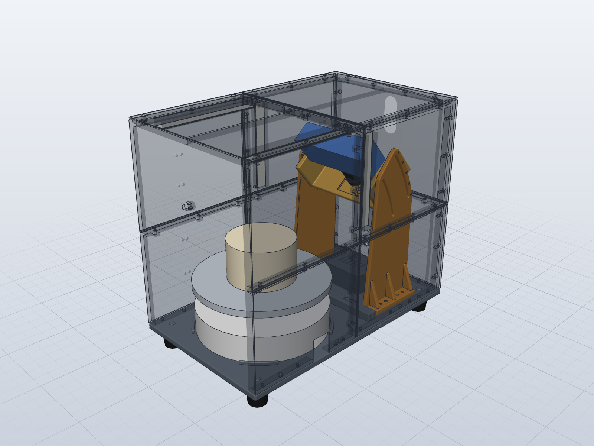

# Scan enclosure: Revopoint MINI 2 + Dual-axis Turntable A230-II

A 3D-printable, closed, matte-black enclosure that holds a dual-axis turntable and a
scanner at a fixed, repeatable pose, for scanning dental models with DentalCraft.
Everything is generated from named parameters (`src/params.py`); scanners and
turntables are profiles, so other hardware can be added later.



| render | file |
|---|---|
| assembled, closed / walls see-through | [assembled.png](renders/assembled.png), [assembled-see-through.png](renders/assembled-see-through.png) |
| exploded | [exploded.png](renders/exploded.png) |
| section in the scanner plane (turntable 0/±30°, view cone, model, adjustment range) | [section-scanner-plane.png](renders/section-scanner-plane.png) |
| cheek foot, before and after the outline fix | [before](renders/closeup-cheek-front-before.png), [after](renders/closeup-cheek-front-after.png) |
| joints: base seam, wall↔roof corner, cheek↔base | [base seam](renders/closeup-joint-base-seam.png), [wall-roof](renders/closeup-joint-wall-roof.png), [cheek-base](renders/closeup-joint-cheek-base.png) |
| rounding: panel corner, panel flange end, base corner, gusset root, slot end | [corner](renders/closeup-round-panel-corner.png), [flange end](renders/closeup-round-flange-end.png), [base corner](renders/closeup-round-base-corner.png), [gusset](renders/closeup-round-gusset-root.png), [slot](renders/closeup-round-slot-end.png) |
| inside fillets: gusset root, rib/boss root (mesh rounding); cradle rounded as exact SolidCraft B-rep | [gusset](renders/closeup-fillet-gusset-root.png), [rib/boss](renders/closeup-fillet-rib-boss-root.png), [B-rep cradle](renders/closeup-brep-cradle.png) |
| lighting: LED channels, light sensor, electronics bay | [channels](renders/closeup-led-channels.png), [sensor](renders/closeup-light-sensor.png), [bay](renders/closeup-electronics-bay.png) |
| foot stub with the sleeve outline | [foot](renders/closeup-foot-stub-sleeve.png) |

## What is in this folder

| path | content |
|---|---|
| `src/params.py` | every parameter: profiles `SCANNERS["mini2"]`, `TURNTABLES["revopoint_a230_ii"]`, `POSE`, `ENCLOSURE`, `PRINTER`, `INSERTS`, `FASTENERS`, `ROUNDING`, `FEET` |
| `src/geom.py`, `src/joints.py` | derived layout and every seam and joint, shared by both parts of a joint |
| `src/parts_*.py`, `src/features.py`, `src/sc.py` | part builders; they emit SolidCraft command scripts run headless by `solidcraft-cli` |
| `src/brep_round.py` | exact B-rep rounding in SolidCraft (`solid.fillet`, `solid.chamfer`), one headless MCP session per part (see Rounding) |
| `src/csg.py`, `src/csg_mesh.py`, `src/csg_plan.py`, `src/round_csg_blender.py`, `src/zones.py` | mesh rounding: every primitive of a part rounded on its own, then unioned in Blender headless (see Rounding) |
| `src/build.py` | builds everything: `step/` (B-rep, assembly pose), `stl/` (rounded, print pose), `cad/parts/*.solidcraft`; per part it keeps the B-rep rounding or falls back to the mesh rounding |
| `src/validate.py`, `src/validate_parts.py`, `src/edges.py` | checks, writes [validation-report.md](validation-report.md) |
| `src/render.py`, `src/section.py`, `src/closeups.py` | renders and `cad/scan-enclosure-assembly.solidcraft` |
| `src/slice_orca.py`, `src/report.py` | OrcaSlicer CLI estimates (isolated datadir), writes [PARTS.md](PARTS.md): parts, seam table, BOM |
| `stl/` | one STL per part, rounded, oriented and resting on Z=0 for printing (`foot_stub` x4) |
| `step/` | one STEP per part in assembly coordinates (exact B-rep; rounded for the parts rounded in SolidCraft, see the method table in the validation report, otherwise without the edge rounding) |
| `3mf/` | one OrcaSlicer project per part (CC2, PETG, settings below) |

Regenerate everything: `make all` (needs `solidcraft-cli`, Blender 4+, Python 3 with numpy, scipy, shapely and
Pillow, and for `make slice` the OrcaSlicer 2.5 AppImage plus the ElegooSlicer system profiles).
Override any parameter: `make all ARGS="distance=200 elevation=45"`; profiles:
`ARGS="--scanner mini2 --turntable revopoint_a230_ii"`. A failing check exits non-zero.

**SolidCraft build.** The current outputs were built with the SolidCraft nightly
`v0.43.0-nightly.20261116.139.1` (portable Linux tarball, not installed; its `--version` prints `0.43.0`).
Every script runs the CLI named by `SOLIDCRAFT_CLI` (default: `solidcraft-cli` on the `PATH`). To reproduce:

```sh
d=$(mktemp -d) && cd "$d"
gh release download -R tangency-labs/solidcraft v0.43.0-nightly.20261116.139.1 \
  -p '*linux-x86_64.tar.gz' -p SHA256SUMS.txt
grep linux-x86_64.tar.gz SHA256SUMS.txt | sha256sum -c - && tar xzf solidcraft-*-linux-x86_64.tar.gz
cd -    # back to hardware/scan-enclosure
SOLIDCRAFT_CLI="$d/solidcraft-0.43.0-nightly.20261116.139.1-linux-x86_64/bin/solidcraft-cli" make all
```

## Layout and pose

World frame: Z up, Z=0 at the underside of the base, turntable centre at X=Y=0, tilt axis
along X (button end -X, DC-jack end +X). The scanner sits on +Y, in the plane of tilt; the
front (-Y) is open. The four foot stubs stand 27.5 mm below Z=0.

| quantity | value |
|---|---|
| outer size W x D x H (without feet) | 240 x 396 x 322 mm |
| base plate | 8.5 mm; the turntable stands on it (Z = 8.5) |
| tilt axis | Z = 43.2 (34.7 above the turntable base) |
| aim point T | 15 mm above the platter centre: (0, 0, 105.2) |
| line of sight | 190 mm from T to the scanner front face, 40° elevation |
| distance adjustment | ±15 mm: the 1/4"-20 screw slides in a slot along the line of sight; ticks every 5 mm |
| elevation adjustment | 30–50°: the cradle turns in two arc slots per cheek centred on the aim line through T, so the axis keeps hitting T; ticks every 5° (long tick = 40°), locked with 4 x M3 + washers |

## Joints and heat-set inserts

All joints use M3 brass heat-set inserts, one rule set for every hole (`INSERTS`, `FASTENERS`):
hole D4.0 x 6.7 (insert length 5.7 + 1.0) with a 0.2 mm lead-in, boss D9 (insert OD 4.8 + 2 x 2.0),
at least 1.5 mm of material behind the hole bottom. Screws: M3 x 8 through 4 mm flanges, M3 x 12
through the cheek feet, cradle slots and base seam rib, M3 x 16 through the foot stubs; thread
engagement 4–5.5 mm, never deeper than the hole. Every seam has 2 or more screws, at most 80 mm apart,
plus alignment (keys, dowels, tongue-and-groove or lips). The full seam table, with the insert side and
the insert axis against the print layers, is in [PARTS.md](PARTS.md).

- Inserts perpendicular to the layers (best): base (walls, back, cheeks, feet), back-wall skin bosses
  (side walls), roof skin bosses (side walls and back wall), cradle side plates (the cradle prints lying
  on a side plate).
- Inserts parallel to the layers: the flange-to-flange seams between coplanar panels (side, back and
  roof halves) and the base seam rib. A flange joint has no other printable direction. Mitigation: the
  boss is a solid block 9 mm wide over the full flange depth, and the parts are sliced with 4 perimeters.
- All screw heads sit on inner faces; no head stands proud of an outside face, so no counterbore is
  needed except the foot stubs (D6.5, head hidden 17.5 mm deep, like the stock Elegoo foot).

### Installing the inserts

- Tool: soldering iron with a flat tip or an M3 insert tip, a flat metal plate to finish flush.
- Temperature: PLA 200–220 °C, PETG 235–250 °C. Start low and go up if the insert needs force.
- Put the insert on the hole (the 0.2 mm lead-in centres it), press straight along the hole axis with
  light pressure and let the heat do the work; stop about 0.5 mm proud, then press it flush with the
  flat plate and hold 5–10 s while it cools. The extra 1 mm of hole depth takes the displaced plastic.
- Inserts parallel to the layers (seam flanges, base seam rib): support the flange from behind, go
  slowly, and keep the iron on the lower end of the range.
- Which side: base top face (walls, back, cheeks) and underside (feet, in the recesses); front face of the
  base_front seam rib; the top seam flange of each lower side/back piece; the rear seam flange of each front
  side piece; the inside face of the back-wall and roof bosses; the front seam flange of roof_front; the
  outer faces of the cradle side plates. Each insert has a free D12 x 25 mm cylinder in front of it
  (checked), so the iron reaches it on the bare printed part.

## Rounding

Every edge is rounded or chamfered (`ROUNDING`): 1.5 mm outer edges, 3 mm on the outer plan corners and
the open-front edges, a 0.8 mm 45° chamfer on edges that touch the print bed (no overhang, no elephant
foot), 0.3 mm lead-ins on fits (holes, dowels, tongues and grooves, keys, slots, the disc channel), 2 mm
on inside corners of an outline. Where a radius does not fit a feature it is reduced to what fits.

Two rounding methods; `build.py` picks one per part (`ROUNDING`: `brep_round`, `brep_budget_s`).

**1. Exact B-rep rounding in SolidCraft** (`src/brep_round.py`, tried first). The part's B-rep is built in
one headless `solidcraft-cli mcp` session and rounded with `solid.fillet` / `solid.chamfer`:

- Order: inside corners first (2 mm, 3 mm on the cheeks), then outer edges (3 mm in the open-front corner
  zone, 1.5 mm elsewhere, also on seam faces), 0.3 mm lead-in chamfers in the fit zones, and the 0.8 mm bed
  chamfer last.
- Edges are classified convex or concave by sampling a small circle round each edge midpoint against
  the part's primitives. Concave edges in a fit zone, on the bed, or in a corner another part sits in
  get no fillet.
- Each group is tried as one feature. A refused group is split in halves down to single edges, and a
  single edge is tried exact, then with `fit: reduce` (kept at 0.5 mm or more). A refused fillet leaves the
  design unchanged. Edges not reached within `brep_budget_s` (240 s) stay as they are.
- The B-rep result is kept when it is a closed manifold and leaves no more exposed sharp edges than the
  mesh rounding (and on a tie, has at least half its inside corners filleted). Then `step/`, the part
  design and the STL are the exact rounded B-rep.

With the SolidCraft nightly `v0.43.0-nightly.20261116.139.1`, B-rep fillets now fail fast (0.2-10 s
instead of about 15 s) and name the edge and the largest radius that fits. Each part still has edges the
kernel refuses. Where many rounds meet (flange ends at bosses, tongues, LED channels, gusset feet), the
refusals are "Fillet Corner Error", "Rollover", "CalcFilletIntSideFace" and "contact line leaves the
face". So the B-rep is kept only on the parts listed in the method table of the validation report.

**2. Mesh rounding** (fallback for every other part). A global mesh bevel failed: where several rounds of
different radius met it left 1437 sharp mesh edges. So every feature is rounded on its own, before the
union (`src/csg*.py`, `src/round_csg_blender.py`, Blender headless with the Manifold boolean solver):

- `csg.py` replays the part's SolidCraft history (boxes, cylinders, sketch extrusions, cuts) as primitives
  in the print frame.
- `csg_plan.py` rounds each join primitive in isolation:
  - its outline corners are rounded in 2D (corner_r on the footprint corners, edge_r elsewhere);
  - each end cap gets the bed chamfer (on Z 0), a quarter-round (free end), or stays flat and reaches
    0.3 mm into the primitive that covers it (buried end), so the union has no coplanar seams.
- Each cut tool is flared at its mouths. Along every column of its wall, the first and last heights with
  material (exact, bisected) get a lead-in chamfer (fit zones), the bed chamfer, or the tool side of a
  quarter-round. The flare is sized to the tool width, the material depth and the wall beside it, and
  sunk 2.5 % so it meets the face at 13° instead of tangent.
- The union of convex rounded bodies has only inside (concave) creases, and the flared cuts leave rounded
  mouths, so no bevel runs on the merged mesh.
- Builders keep features off the rounds of other features: the jack notch is built around (skin and foot
  flange stop, a bridge spans it), the USB slot is one obround cut, the back ribs end inside the top
  flange, the roof front lips and flange stop 1.5 mm behind the rounded front edge, and wire passages are
  closed holes, not open notches.

Consequences of the mesh rounding:

- `stl/` and `3mf/` are rounded; for these parts `step/` and the SolidCraft part designs are the exact,
  unrounded B-rep.
- Inside fillets are solids too (`src/csg_fillet.py`, switch `fillet_solids` in `ROUNDING`), unioned with the
  pieces:
  - **Fillet feet.** A piece standing on a support face gets a concave foot all round its outline: a
    flange or rib on a skin, a web or boss on a flange or wall, a channel wall, a rib on the plate. The
    foot is `fillet_in_r` = 2 mm (3 mm on the cheeks).
    - It stays on the flat part of the support and clear of the mating parts, and stays full against an
      abutting feature, where it is buried anyway.
    - It runs out at a slope of 0.2 where the support ends.
  - **Fillet strips.** Where an end face of a piece meets the support its edge is buried in (the gusset
    sides on the cheek plate and foot), a straight strip carries the concave profile. The piece keeps
    that buried edge square, so there is no groove under the strip. At a free end the arc shrinks into
    the corner, so the strip ends buried. The gusset tips run 3 mm into the plate and the foot.
  - **Pocket floors and corners.** A cut that stops inside the material (the bay-cover hollow, the foot
    recess) has its buried end and its corners rounded, which gives the part an inside fillet.
  - Fillets are sunk 2.5 % into the air, so they meet the faces at 13° instead of tangent.
  - **Fallback.** After the union, `build.py` compares the part with its fillet-free build. For every new
    sharp edge it drops the nearest fillet and rebuilds (up to 8 passes). A part that would not be a
    closed manifold is built without fillets. The validation report counts the inside corners that end
    up without a fillet.
  - Not covered yet: vertical inside corners where two walls meet (flange to flange, web to flange). Two
    approaches were tried and reverted:
    - vertical strips, which creased where they met the feet;
    - one merged outline per wall group, which made the fallback drop more feet.
- `validate.py` checks that rounding never grows a part and that every rounded surface stays within 3.5 mm
  of the B-rep. It counts the sharp convex edges left (faces turning by more than 30°), split into exempt
  ones (bed chamfer, fit lead-ins, covered by a mating part) and exposed ones; see the validation report
  and the open points.

## Feet

Four printed `foot_stub` parts replicate the Centauri Carbon 2 stock foot (D31.5 at the base end, D26.5
at the table end, 29 mm tall), so the genuine Elegoo anti-vibration sleeves slip on them as on the printer.
Each stub sits in a 1.5 mm locating recess under the base and is held by an M3 x 16 into an insert in the
base, head hidden in a counterbore. The stub is a solid of revolution, so turning in its recess changes
nothing: no anti-rotation keys. Four feet, 25 mm in from the edges (sleeve D40 + 5 mm), on one base half
each and 25 mm off the seam. A fifth, centre foot was not added: the walls and the bolted seam rib make the
base a stiff box, and five feet would rock on an uneven table (and need a second sleeve pack).

## Lighting

The mechanical interface comes from the lighting and electronics design ([`electronics/`](electronics/)).
It is parametric in `LIGHTING` (`src/params.py`, `src/parts_led.py`).

- **LED channels**: two on the `roof_front` underside (X ±90, channel Y −95..+65, aperture down) and one on
  each upper rear side panel (Y 95, Z 170..305, aperture towards the middle).
  - Section: inner width 16, walls 1.6 × 12.6 high, a 1.4 × 1.0 cover groove in each wall 10 mm above the
    skin (strip top to cover 8 mm).
  - Covers: natural PETG, 17.7 × 1.2 × (channel − 1) (`led_cover_roof_left/right`, `led_cover_wall_left/right`),
    sliding in from the open end.
  - The closed end has a 1.6 mm end wall with a Ø3 wire hole 1.5 mm above the skin. Roof channels are
    closed at the rear; wall channels at the bottom, so the cover rests on the end wall.
  - On the wall runs the +Y wall extends 8 mm past the cover face as a visor.
  - Every lit cover face stays at least 3° outside the camera view cone over 30–50° and 175–205 mm
    (validated).
- **Light sensor** (TEPT5700) on the inside of `side_left_front_upper`.
  - Dome tip at (−110, −40, 180), axis 10° from vertical towards the front, facing the lit roof.
  - Holder: a Ø16 tube whose flat top is the collar, 0.5 mm under the tip, on a block to the wall. Bore
    Ø5.2, flange counterbore Ø6.0 × 1.5 from below. The collar hides the platter and the model envelope
    at every tilt (validated).
  - The sensor goes in from below and is glued; the leads drop down the wall into the harness clips at
    Y −50.
- **Electronics bay** on `base_rear` between the cheeks.
  - Board: 60 × 40 perfboard on 4 standoffs 6 mm high (M3 inserts, holes 53.34 × 33.02).
  - Vented `bay_cover`, M3 × 8 into 4 posts, with 22 mm free above the board and 10 mm beside the
    terminal edge. A Ø10 harness hole sits 3.5 mm above the base, facing the back.
  - Panel holes in `back_lower` at 25 mm pitch, Z 35: DC-022B jack Ø8.2, MTS-102 toggle Ø6.5, 16 mm pot Ø7.5
    with a Ø3.2 anti-rotation hole 8 mm above it, power LED Ø3.1.
- **Cable routing**:
  - Harness: from the bay across `base_rear`, along the −X lower walls at Z 30, then up the −X front wall at
    Y −50 (clips every ~60 mm).
  - Into the roof: through a Ø4 hole in the left roof lip, then across `roof_front` at Y 58 (clips, Ø4
    hole in the centre rib) to both roof channels.
  - To the wall channels: over the Y 72 seam through Ø4 holes in the `roof_rear` lips at Y 82, down to the
    wall channels.
  - Sensor lead: into the riser clips at Y −50, then the Z 30 run.
- Every lighting feature stays clear of the turntable sweep, the view cone and the DC-jack and USB-C
  pass-throughs (validated).

## Lighting electronics (automatic brightness, no microcontroller)

Design, circuit and build of the LED lighting are in [`electronics/`](electronics/):

- [LIGHTING.md](electronics/LIGHTING.md): which light helps or hurts the MINI 2 and why (4000 K, CRI > 90, flicker-free DC dimming, diffuse light, no IR). It also covers the strip choice, the run positions and lengths, the diffuser channel cross-section and print settings, the sensor placement, and a short evaluation of an Arduino version.
- [DESIGN.md](electronics/DESIGN.md): the analog loop (TEPT5700 sensor → LM358 integrator → linear constant-current MOSFET driver), every value and calculation, and the numerical verification.
  - Plots: [step response](electronics/step_response.png), [room light](electronics/room_light.png), [Bode](electronics/loop_bode.png), [MOSFET dissipation](electronics/mosfet_dissipation.png).
- [schematic](electronics/schematic.png) ([svg](electronics/schematic.svg)) and a checked 60 × 40 mm [perfboard layout](electronics/perfboard.png) with a [wiring list](electronics/perfboard-wiring.md).
- [BOM.md](electronics/BOM.md) (about €19 in total, €6 for the controller); [ASSEMBLY.md](electronics/ASSEMBLY.md) covers wiring, calibration and safety.
- Sources: `electronics/sim/*.py` (numpy, scipy, matplotlib, schemdraw).

There is no KiCad project yet; one can be drawn from the schematic if a manufactured PCB is wanted.

## BOM

Exact counts per seam are in [PARTS.md](PARTS.md).

| item | qty |
|---|---|
| M3 heat-set inserts (OD about 4.8, length 5.7) | 105 |
| M3 x 8 / M3 x 12 / M3 x 16 socket head | 89 / 12 / 4 |
| M3 washers | 4 (cradle screws in the arc slots) |
| 1/4"-20 x 1/2" screw + 1/4" washer | 1 (cradle into the Quick Mount disc, from below) |
| Elegoo Anti-Vibration Feet for Centauri Carbon 2 Series (4 pcs), SKU GWCZ-EL-3DF-AC0325, <https://eu.elegoo.com/products/anti-vibration-feet-for-centauri-carbon-2-4-pcs> | 1 pack |
| printed dowel pins (on the base) | see PARTS.md |

## Print settings

- Elegoo Centauri Carbon 2, 0.4 mm nozzle, Textured PEI plate, 0.20 mm layers.
- Matte black PLA (stiffer, more accurate) or PETG (if the room gets warm). Parts that carry LED channels
  (`roof_front`, `side_*_rear_upper`) in PETG (PLA only if the strips run at 50 % or less); the four LED
  covers in natural (translucent) PETG.
- 4 walls (around the insert bosses), 20 % infill, **no supports**, one part per plate in the STL
  orientation: panels skin-down, base flat, cheeks inner face down, cradle on a side plate, foot stubs on
  their large end.
- `base_front` is 240 x 250 mm: keep it out of the CC2's excluded front-right corner (Orca's arrange does
  it; the 3MF files in `3mf/` are already arranged). A 5 mm brim helps the two base plates.
- Print one flange with an insert first to check your inserts and temperature.

## Assembly

1. Heat-set all inserts (see above).
2. Base: keys of `base_front` into the notches of `base_rear`; screws through the rear seam rib.
3. Foot stubs: into the recesses under the base, M3 x 16 from the table end; slip the sleeves on.
4. Cheeks: on `base_rear` (dowels into the foot holes), screws down through the feet.
5. Cradle: between the cheeks, M3 x 12 + washers through the arc slots; screw heads on the 40° tick.
6. Scanner: Quick Mount disc into the channel, 1/4"-20 x 1/2" + washer from below; disc front edge on
   the long tick (190 mm); the scanner's end faces sit between the guides.
7. Turntable: on the locating arcs, DC jack towards +X (the notch side).
8. Lower side walls: join front and rear pieces (seam flange screws), set them on the base (dowels), screw
   down. `back_lower`: between the side walls, onto its dowels, screw down; then the side-wall rear flange
   screws, from inside, into the back-wall bosses.
9. Upper side walls and `back_upper`: tongues into the grooves, seam screws from inside, side-to-back screws.
10. Roof: screw `roof_front` and `roof_rear` together on the bench, lay it on (its lips locate it inside
    the walls), then screw up from inside through the side and back top flanges into the roof bosses
    (a short ball-end hex key through the open front).
11. Cables: DC through the side notch, USB-C up and out through the back-wall slot.
12. Lighting (before the walls go on, see [electronics/ASSEMBLY.md](electronics/ASSEMBLY.md)): board on the
    bay standoffs, panel parts into `back_lower`, strips into the channels and covers slid in from the
    open ends, sensor glued into its holder from below; thread the harness through the bay-cover hole and
    the roof wire holes before soldering, clip it along the route.

## Measure before printing

Low/medium-confidence numbers; change the parameter, run `make all`, check that validation passes.

| measure | default | parameter |
|---|---|---|
| Quick Mount disc diameter | 35 mm | `mount_disc_d` |
| MINI 2 underside to disc bottom (stack height) | 40 mm | `mount_stack` (moves the aim: must be right) |
| disc centre vs body centre, front-back / sideways | 0 / 0 | `mount_off_s` / `mount_off_x` |
| depth of the disc's 1/4" thread | ~6 mm | 1/4" screw length; `cradle_plate_under` |
| MINI 2 body 132 x 53 x 36; end faces flat in the bottom 10 mm | | `body_w/h/d`, `end_guide_overlap` |
| optical centre vs front-face centre (up/down) | 0 | `optic_off_t` |
| turntable base: diameter and shape (196–200 mm) | D200, round | `base_d`, `base_shape` |
| tilt-axis height above the base bottom | 34.7 ±1.5 | `tilt_axis_h` |
| platter top above the tilt axis | 47 | `platter_above_axis` |
| label on the turntable: **A230 vs A230-II** | A230-II | another model = another `TURNTABLES` profile |
| DC jack: which end, height, position along Y | +X, 8 mm, centred | `jack_side`, `jack_h`, `jack_notch_w/h` |
| stock foot on your CC2: D at both ends, height | 31.5 / 26.5 / 29 | `foot_d_top`, `foot_d_bottom`, `foot_h` |
| Elegoo sleeve: bore D and depth, outside D | about 32 / 13 / 40 | `foot_d_top`, `sleeve_d` |
| your inserts: OD and length | 4.8 x 5.7 | `INSERTS["M3"]` (`od`, `length`, `hole_d`) |
| printer fit (test keys/tongues) | 0.2/0.15 mm | `key_fit`, `groove_fit`, `fit`, `dowel_fit` |

## Calibrate in DentalCraft after assembly

The printed pose is nominal; DentalCraft measures the real one.

1. Open the scan popup, connect the MINI 2 and the turntable. Do not move either during calibration.
2. Put a static, textured object on the platter (a dental model).
3. Press **Calibrate** in the turntable section of the popup (command `turntable.calibrate`, from the
   CLI/MCP too; optional `steps` 3–36, default 8, and `step_deg` 5–120, default 45). In the background
   the table turns once to learn the static background (the enclosure is then removed from the frames),
   turns again in steps while the scanner tracks the object (rotation axis), then tilts both ways
   (tilt axis); the platter plane is taken from the fused points.
4. Check `turntable.calibration`: `fit_rms_deg` and `fit_rms_mm` should be small. `scan.auto` refuses
   to run without a calibration matching this scanner and turntable.
5. Calibrate again after any change of elevation or distance, after moving the turntable, or after
   re-seating the scanner.

## Adding another scanner or turntable

1. Add an entry to `SCANNERS` or `TURNTABLES` in `src/params.py`, copying every key of the existing
   profile (`load()` rejects duplicates and unknown overrides):
   ```python
   SCANNERS["my_scanner"] = dict(SCANNERS["mini2"], label="My scanner",
                                 body_w=150.0, body_h=60.0, body_d=40.0, mount_stack=35.0)
   ```
2. If the new hardware needs another working pose, override `POSE` values on the command line or edit them.
3. `make all ARGS="--scanner my_scanner --turntable revopoint_a230_ii"`.
4. Read `validation-report.md`: parts over 250 mm, clearance under 10 mm, a blocked view cone, a joint or
   insert rule broken, or material outside a part's outline fail the run. The cheek is the tallest part
   (246 mm): longer distances or higher elevations make it taller; lower `bolt_t` or `bolt_ds`, or raise
   `elev_min`, to bring it back.

New mount types (no Quick Mount disc) need a new cradle builder in `src/parts_tower.py`; a turntable with
a different footprint uses `base_shape="rect"` or a new locator in `src/parts_base.py`.

## Validation

`make validate` (report: [validation-report.md](validation-report.md)) checks print size and build volume,
closed manifold meshes, the optical axis rebuilt from the cradle mesh (through T at 190/175/205 mm, 40°),
the cheek slots over 30–50°, platter + model clearance (≥10 mm, ±30° tilt), the view cone, USB-C space and
scanner travel, ribs inside their outline, every joint (coaxial holes ±0.2 mm, insert depth, floor, boss
wall, iron access, screw length, insert spacing), the feet, the rounding, and the lighting (lit covers ≥3°
outside the view cone at every pose, the sensor collar hiding platter and model at every tilt).

## Open points

- Rounding: the strict sharp-edge check and the inside-fillet check are reported in
  `validation-report.md` (section 9). Edges and samples that fail are listed in `build/build.json`
  (`exposed_sharp`, `listed_sharp`).
  - Listed exception: the end of the `base_front` seam rib on the seam face. It lies within 0.5 mm of
    `base_rear`'s rib face and is hidden once the base is bolted.
  - 36 exposed edges (42 before the B-rep rounding; the cradle went from 6 to 0). They are short creases
    where fillets, buried ends and cut mouths meet, all on parts that keep the mesh rounding:
    - side-panel flange ends at the back-wall boss plane (Y 268), the open front (Y −120) and the seam
      flange (Z 153): 19;
    - the closed ends of the LED channels (roof Y 66, walls Z 168): 14;
    - the sensor holder: 3.
- Inside fillets are incomplete, so the "inside corners ≥ 2 mm" check fails. Of 6986 non-exempt
  inside-corner samples, 2836 have a fillet and 4150 do not (before: 2782 and 4204; the cradle's 54 are
  now exact B-rep fillets). The counts per part are in `validation-report.md`. Corners without a fillet are:
  - vertical wall-to-wall corners (no strip yet);
  - feet and strips the fallback dropped;
  - the cheek gussets, whose strips crease where the squared edge turns round the foot end;
  - inside corners of cuts that are not pockets.
- SolidCraft B-rep rounding (nightly `v0.43.0-nightly.20261116.139.1`) holds only on the cradle. On the
  other parts the kernel refuses edges where many rounds meet, or the 240 s budget runs out. Those
  parts would keep more exposed creases than the mesh rounding (method table in the validation report).
  On `bay_cover`, one fillet call ran for more than 6 minutes; a 300 s watchdog per call now falls back to
  the mesh rounding. The inside fillets alone do build as B-rep on most side panels (for example 32/32
  on `side_right_rear_lower`), but their outer edges do not all build, so those parts stay on the mesh
  rounding.
- `step/` and the SolidCraft part designs are the exact B-rep: rounded for the cradle, without the edge
  rounding for the mesh-rounded parts; `stl/`, `3mf/` and `cad/scan-enclosure-assembly.solidcraft` carry
  the rounding of every part.
- Panel seams and the base seam rib have inserts parallel to the layers (no other printable direction).
- The front is open, without a door.
- The turntable is modelled as a base disc and a platter only; the view-cone angles are estimates.
