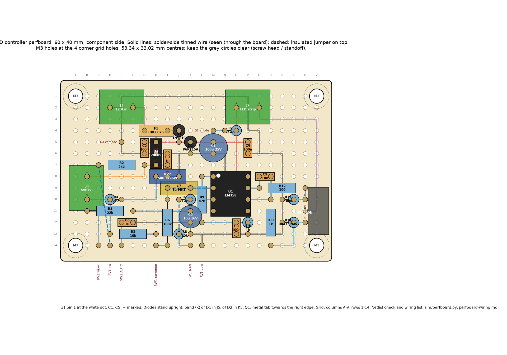

# Assembly, wiring and calibration

Parts: [BOM.md](BOM.md). Circuit: [schematic.png](schematic.png). Board: [perfboard.png](perfboard.png) and the
hole-by-hole list [perfboard-wiring.md](perfboard-wiring.md). Why each value: [DESIGN.md](DESIGN.md).

## 1. Build the board

1. **Cut the board.** Cut a 0.1" perfboard to 60 × 40 mm with 22 × 14 holes (columns A–V, rows 1–14), the
   grid centred. Drill the four corner holes A1, V1, A14 and V14 to 3.2 mm (M3, centres 53.34 × 33.02 mm).
2. **Fit parts lowest first:**
   1. lying resistors;
   2. standing resistors and diodes;
   3. the DIP-8 socket, MLCCs, trimmer and film capacitor;
   4. electrolytics, TO-92, PTC, terminals, Q1 (tab towards the right edge).

   Pin positions are in the *Parts* table of perfboard-wiring.md. Watch the polarities:
   - U1: pin 1 at the white dot (M8).
   - C1 and C5: + marked (M5, K11).
   - D1 and D2 stand upright: band (cathode) of D1 in J5, of D2 in K5, both on the +12 V row.
   - U2 78L05: flat face as drawn, IN H5, GND H6, OUT H7.
   - Q1: G U10, D U11, S U12.
3. **Solder-side wires.** Lay bare tinned wire along the paths in the *Solder-side wires* table, hole by hole.
   Only the holes listed belong to a net; where a trail passes between two pads, keep it centred.
4. **Jumpers.** Fit the three insulated jumpers on the component side: INV_A I9–M9, MFB J10–J13, POT_TOP C7–D14.
5. **Check before power.** With a meter on resistance, check for **no short** between +12 V (J5) and GND (G6),
   +5 V (H7) and GND, and between J2 + and J2 K. Then fit the LM358 into its socket.
6. **Panel wires** (about 15 cm each, from the bay on `base_rear` to the `back_lower` panel), from the bottom-edge pads:

   | pad | to |
   |---|---|
   | C14 RV1 wiper | RV1 middle lug |
   | D14 RV1 cw | RV1 lug that is "up" when the knob turns clockwise |
   | L14 RV1 ccw | RV1 other end lug (GND) |
   | E14 SW1 AUTO | SW1 outer lug, marked AUTO |
   | H14 SW1 common | SW1 middle lug |
   | K14 SW1 MAN | SW1 other outer lug |
   | M4 D3 anode | D3 long lead |
   | E5 D3 cathode | D3 short lead |
   | J1 + / J1 − | JK1 centre pin (+) / sleeve (−) |

## 2. Wire the enclosure

The board sits in the vented electronics bay on `base_rear`, between the cheeks: 4 × M3 on 6 mm standoffs.
The jack, the toggle, the knob and the power LED are in the `back_lower` panel (25 mm pitch). All wires
follow the CAD's cable guides; none crosses the camera's view (the open area in front of and below the scanner).

- **Strips.** Cut the FCOB strip only at the marked 25 mm cut points:
  - 2 × 150 mm (6 cuts) for the roof;
  - 2 × 125 mm (5 cuts) for the side walls.

  Stick each strip centred on the channel skin, then wire all four in parallel, + to + and − to −, with
  AWG22. Every pass-through is a closed round hole, so **thread the wires through before soldering**. Route:
  1. From J2 (+ red, K black), the harness leaves the bay through the Ø10 hole in its cover wall facing the
     back. Thread it before connecting it to J2.
  2. It runs along the base and the −X lower wall in the Z 30 guide to Y ≈ −50.
  3. It runs up the inside of the −X wall at Y ≈ −50 in the clips.
  4. It passes through the Ø4 hole in the left `roof_front` lip at Y −50, to the front end of roof_left. The
     channel's open end is at the front, so the wires enter under the cover end.
  5. From the rear end of roof_left (Ø3 hole in the end wall), a pair goes across the roof at Y 58, in the clips
     and through the Ø4 hole in the roof centre rib, to the rear end of roof_right.
  6. From each roof run's rear end, a pair goes through the Ø4 hole in the `roof_rear` lip at Y 82 (it crosses
     the Y 72 seam) and enters the top end of the wall run on the same side. That end is open; the bottom end
     is closed.

  Order:
  - Slide the wall-run covers in from the top **before the roof goes on**. The closed bottom end holds them.
  - Slide the roof covers in from the front end.
  - Harness length: about 1.3 m of 2-core AWG22 in total.

  Solder to the strip pads and cover them with heat-shrink.
- **Sensor.** Solder 2 wires to PH1, about 60 cm, twisted:
  - **collector** goes to **J3 +**. Find which lead it is on the package drawing in the Vishay TEPT5700 datasheet (doc 81321). Check before you heat-shrink: wired the right way, the voltage on J3 S rises when you shine a phone torch on the sensor, and stays near 0 V in the dark;
  - **emitter** goes to **J3 S**.

  Heat-shrink the leads. Push PH1 into its holder (on the −X wall at Y −40, Z 180) **from below** until the
  flange sits in the counterbore and the dome stands 0.5 mm above the Ø16 collar. Fix it with a drop of glue
  from below. The leads drop down the inside of the −X wall into the strip-harness clips at Y −50, then follow
  the Z 30 guide with the harness, through the bay's Ø10 hole, to J3.
- **Power.** Plug the 12 V adapter (≥ 1 A, centre positive) into JK1. **Not** the turntable's adapter: see LIGHTING.md §3.

## 3. First power-up

1. Before fitting U1, power the board with the strip and sensor unplugged. D3 lights. Measure about 11.6 V on
   U1 socket pin 8 and 5.0 V ± 0.25 V on H7. Unplug and fit U1.
2. Plug the strip in. Set SW1 to MAN and the knob to minimum: the strip is off. Turn the knob up slowly: the
   light ramps smoothly (about 0.2 s lag) up to full.
3. **Measure the strip current at full** (MAN, knob at maximum): put a meter in series with J2 K, or measure the
   voltage across R14 (Q1 source U12 to GND) and divide by 0.47 Ω.
   - Expect up to about 0.38 A with a 12.0 V adapter and 0.40 A at most.
   - If it stays well below 0.3 A, the strip needs more voltage than modelled: use a 12.5–12.6 V adapter. Nothing else changes.
4. Plug the sensor in.

## 4. Calibrate the sensor (once)

This makes "knob fully clockwise in AUTO" equal to "the most light the strip can give". It also sets the
loop speed (see DESIGN.md: R_L normalises both).

1. Darken the room or cover the open front with cardboard; no model on the platter.
2. SW1 to AUTO, knob fully clockwise.
3. **Multimeter method:**
   - With SW1 in MAN and the knob at maximum, measure J3 S to GND (sensor voltage).
   - Turn RV2 until it reads **4.0 V**.
   - Switch back to AUTO.
4. **No-multimeter method:**
   - Start with RV2 turned to maximum resistance (about 25 turns one way). The strip is then dim in AUTO.
   - Turn RV2 the other way until the strip reaches full brightness. Then go back until it **just begins to
     dim** and stop there.
5. Seal the trimmer with a drop of nail varnish.

## 5. Set the working level

The knob is linear: in AUTO it sets the light at the model, from 0 to the strip maximum (about 425 lx on
the faces the camera sees, about 925 lx on top faces; see LIGHTING.md). Room light that reaches the
sensor is subtracted automatically.

- **With a phone lux app:**
  1. Lay the phone face up on the platter, its light sensor at the model height (about 40 mm above the platter, on a box).
  2. In AUTO, set the knob for **400–600 lx** for texture scans. That reading is on a face looking up.
  3. For geometry-only scans (no texture), **150–250 lx** is enough. Less ambient light in the projector band gives cleaner depth.
- **By eye in DentalCraft:**
  1. Open the scan popup with the MINI 2 connected and watch the live RGB view of a dental model.
  2. Raise the knob until the texture is evenly exposed with **no white blown-out patches** on the glossy
     cusps, then back off a little.
  3. In the depth view, if holes appear on bright stone when the light rises, the ambient is competing with
     the projector: lower the knob.
- Mark the two knob positions (texture and geometry) on the panel.

## 6. Safety

- 12 V DC, at most 0.45 A (limited by the circuit) and 0.75 A (PTC fuse). No mains voltage anywhere in the
  enclosure; use only a certified 12 V adapter.
- Reverse polarity is blocked by D1. Adapters above about 15 V make D2 conduct and F1 open: unplug, use the
  right adapter, and the PTC resets by itself after a minute.
- Q1 runs up to about 0.45 W and 30 K above the air: warm, not hot. Keep the bay cover's vent slots open; no heatsink
  is needed.
- The strips and the channels they sit on get warm at full power (about 7 W/m). Use PETG for the parts that
  carry channels. Do not run PLA parts at full power for hours, or move to the aluminium profiles (LIGHTING.md §4).
- Do not look straight into a bare COB strip at full current during assembly. Behind the covers it is diffuse and safe.
- If the sensor wire breaks or is unplugged, AUTO turns the light up to full (current-limited, safe). Switch
  to MAN and fix the wire.

## 7. Troubleshooting

| symptom | cause / fix |
|---|---|
| D3 off | adapter polarity (centre must be +), PTC tripped (wait), F1/D1 orientation |
| strip always off | Q1 pins swapped (G U10, D U11, S U12); LM358 not in its socket or rotated; J2 wires swapped |
| strip always full in AUTO | sensor unplugged or reversed (collector to J3 +); RV2 at its minimum resistance |
| AUTO brightness drifts or pumps slowly | C7 is not a film capacitor (electrolytic leakage); room light flickering at a few Hz (rare) |
| AUTO reacts when the turntable turns | the sensor sees the model or the platter: check the collar, and that the sensor faces up |
| full brightness lower than expected | adapter below 12 V or long thin adapter cable; measure the current (§3 step 3) |
