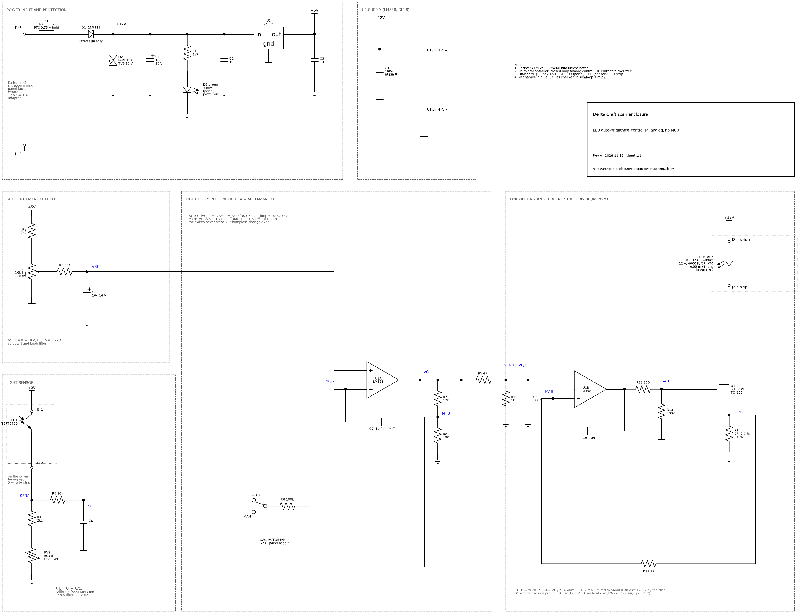

# Automatic-brightness controller: circuit, calculations, verification

An analog closed loop with **no microcontroller**. A light sensor at the model feeds an op-amp
integrator, which drives a linear constant-current LED driver (DC, no PWM). A knob sets the light level;
a switch chooses AUTO (closed loop) or MAN (fixed level).



Files:

- [schematic.svg](schematic.svg) / [schematic.png](schematic.png)
- [perfboard.svg](perfboard.svg) / [perfboard.png](perfboard.png)
- [BOM.md](BOM.md), [ASSEMBLY.md](ASSEMBLY.md), [LIGHTING.md](LIGHTING.md)
- Plots: [step_response.png](step_response.png), [room_light.png](room_light.png), [loop_bode.png](loop_bode.png), [mosfet_dissipation.png](mosfet_dissipation.png)
- Sources in `sim/`: `photometry.py`, `loop_sim.py`, `schematic.py`, `perfboard.py`

There is no KiCad project yet: KiCad was not installed. The schematic and the perfboard come from
Python and the netlist is checked by `sim/perfboard.py`. A KiCad project can be drawn from the schematic
if a PCB is wanted later.

## 1. Topology and why

```
 knob RV1 ─R3/C5─► VSET ─►(+)                  VC        VCMD = VC/48
                         U1A integrator ──┬──R9──┬──►(+) U1B ─R12─► Q1 gate      strip + ── +12V
 sensor PH1 ─R5/C6─► SF ─►SW1─R6─►(−)  C7 │      R10                  Q1 drain ── strip −
                         MAN: R7/R8 of VC ┘                (−)◄─R11── SENSE ─R14─ GND
```

- **Sensor.** A TEPT5700 phototransistor (eye-matched response) loaded by R_L = R4 + RV2 gives
  V_S ∝ illuminance. It is linear over decades, costs €0.40, and its response peaks at 570 nm with a 440–800 nm band:
  close to what the RGB camera exposes for. Two alternatives were rejected:
  - an LDR (CdS): not linear, has memory and is slow, and cadmium is restricted by RoHS;
  - a photodiode with a transimpedance stage: the most linear, but it needs another op-amp, and an eye-matched photodiode (e.g. BPW21R) costs about €8.
- **Error amplifier.** U1A (LM358, single supply, inputs work down to 0 V) is a pure integrator,
  so the steady-state error is zero. Plant and loop are first order, so there is no overshoot.
- **Driver.** U1B, Q1 and R14 form a constant-current sink, I = VC/22.6 Ω. The current loop makes the light
  loop gain independent of the MOSFET threshold. Dimming is DC (see LIGHTING.md §2).
- **AUTO/MAN.** SW1 changes only what R6 feeds into the integrator: the sensor (AUTO) or a fixed fraction of
  VC (MAN, so VC → 2.2 × VSET). The integrator keeps its state, so switching never steps the light. One knob
  serves both modes.
- **Soft start.** At power-on C5 and C7 are empty, so VC starts at 0 V and rises with VSET (R3·C5 = 0.22 s) and
  the loop.

## 2. Component values and calculations

### Input and protection

| part | value | calculation |
|---|---|---|
| F1 | PTC RXEF075 (0.75 A hold, 1.5 A trip, 72 V) | load ≤ 0.452 A (current command limit) + 10 mA; at 50 °C the hold current derates to about 0.6 A, still > 0.46 A. Trips on a short, or when D2 clamps an overvoltage |
| D1 | 1N5819, 1 A 40 V Schottky, series | blocks reverse polarity; 0.40 V × 0.38 A = 0.15 W. DO-41 leads fit perfboard holes (a 1N5822 would not) |
| D2 | P6KE15A TVS | V_RWM 12.8 V (a 12.6 V adapter is below it), V_BR 14.3–15.8 V. With a 19–24 V adapter it conducts and F1 opens |
| C1 | 100 µF 25 V | bulk reservoir for the long strip leads and adapter cable |
| U2 | 78L05 + C2 100 nF, C3 1 µF | load ≈ 2 mA (sensor ≤ 0.9 mA, pot 0.41 mA, bias); P = (11.6 − 5) × 2 mA = 13 mW |
| R1, D3 | 4.7 kΩ, 3 mm green | (11.6 − 2.0) V / 4.7 kΩ = 2.0 mA power-on lamp |
| supply | 12 V ≥ 1 A, separate from the turntable | 0.46 A max; see LIGHTING.md §3 |

### Setpoint

- **Range:** VSET = 5 V × α × 10 k/(10 k + 2.2 k) = **0 – 4.10 V** (α = knob position). R2 keeps VSET below the
  TEPT5700 saturation (V_CE ≥ 0.9 V) and the LM358 common-mode limit (V+ − 1.5 V).
- **Filter:** R3·C5 = 22 kΩ × 10 µF = **0.22 s**. This gives the soft start and removes knob scratch noise. LM358
  bias (45 nA typ, 250 nA max) × 22 kΩ = 1–5.5 mV, which is negligible.
- **Meaning of the knob:**
  - AUTO: after calibration (ASSEMBLY.md), knob fully clockwise = the full light the strip can give. The scale is
    linear in sensor reading, so the knob sets the illuminance from 0 to about 950 lx at the sensor, which is
    0–425 lx on the camera-side faces of the model and 0–925 lx on top.
  - MAN: knob = current, 0–0.40 A.

### Sensor stage

- **Sensitivity:** TEPT5700, I_PCE = 5.2–24 µA at 20 lx (groups A–C, 4.6:1 spread). Geometric mean 0.56 µA/lx,
  typical 0.75 µA/lx at 100 lx. V_CEO is 6 V, so it runs from the 5 V rail.
- **Load:** R_L = R4 + RV2 = 2.2–52.2 kΩ. Calibration sets V_S = 4.10 V at full light with the room dark.
  Expected R_L: typical 7.7 kΩ, group A 16.5 kΩ, group C 3.6 kΩ, all inside the range.
- **Why calibrate R_L:** it removes the 4.6:1 sensor spread from **both** the setpoint scale and the loop gain.
- **Filter:** τ = (R_L + R5)·C6 = (3.6–16.5 k + 10 k) × 1 µF = **14–27 ms** (6–12 Hz). It attenuates 100 Hz room-light
  ripple by 9–17×; the integrator then attenuates it another ~120×.
- **Dark current:** ≤ 50 nA × R_L ≤ 0.8 mV, which is negligible.

### Integrator U1A (light loop)

- **Integrator:** R6·C7 = 100 kΩ × 1 µF = **0.1 s**. C7 must be a film capacitor. An electrolytic's leakage would
  act as a resistor across it and leave a steady error.
- **Plant gain:** G_p = dV_S/dVC = (1/48/0.47 Ω) × d(illuminance)/dI × S × R_L = **0.32–0.68 V/V** over:
  - sensor gain −25 %…+33 % after calibration (temperature, calibration error, ageing);
  - current 10–75 % (LED droop).
- **Loop:** L(s) = G_p / (s R6 C7) × 1/(1 + s τ_filter) × (two poles above 1 kHz).
  - crossover ω_c = G_p/(R6 C7) = **3.2–6.8 rad/s (0.5–1.1 Hz)**;
  - phase margin **83–87°**;
  - closed-loop τ = 1/ω_c = **0.15–0.31 s**.
- **Response time:** 10–90 % rise 0.35–0.7 s; settling to ±2 % in **1.0–1.6 s**. That is fast enough to follow a
  door opening or a lamp switched on, and slow enough not to react to 100 Hz flicker, the projector's
  3–10 Hz flashes, or noise. With 82° of phase margin the loop does not hunt. The camera's auto-exposure is not
  part of this loop, so the two cannot oscillate against each other.
- **Manual mode:** R7/R8 = 12 k/10 k, k_m = 0.4545; VC → VSET/k_m = 0–9.0 V; τ = R6·C7/k_m = 0.22 s.
- **Offsets:** LM358 bias × R6 = 4.5 mV typ (25 mV max) on a 4.1 V scale; offset 2–7 mV. Both are inside the
  calibration.

### Current driver U1B, Q1, R14

| quantity | value |
|---|---|
| VCMD | VC × R10/(R9 + R10) = VC/48 (0 – 0.212 V for VC 0 – 10.2 V; LM358 high output at 11.6 V supply) |
| I_LED | VCMD/R14 = VC/22.6 Ω, **0–0.452 A**: always below the strip rating (0.504 A for 0.55 m) |
| strip headroom | 12.0 V − 0.2 (F1) − 0.40 (D1) − 0.18 (R14) − 0.10 (Q1 R_DS) → the strip reaches **0.38 A** at 12.0 V in, 0.31 A at 11.4 V, 0.45 A at 12.6 V. Above that, Q1 is fully on and the light is simply at maximum |
| R14 | 0.47 Ω 1 %, 0.5–0.6 W: 0.45² × 0.47 = 95 mW (19 % of 0.5 W) |
| offset | LM358 ±7 mV max → ±15 mA in MAN (AUTO calibrates it out) |
| compensation | R11 1 k + C9 10 n (τ = 10 µs), R12 100 Ω gate stopper, R13 100 k pull-down (Q1 off while U1 powers up), C8 100 n on VCMD (0.1 ms) |
| inner loop (model) | crossover 0.64 MHz, phase margin 68°; I/VCMD bandwidth 0.36 kHz (at 5 mA) to 6.5 kHz (at 0.4 A). That is ≥ 400× faster than the light loop, so the light loop sees it as a static gain |

**Q1 IRF520N** (TO-220): V_DS 100 V, I_D 9.7 A, R_DS(on) ≤ 0.20 Ω at V_GS 10 V, V_GS(th) 2–4 V, R_thJA 62 K/W.

- **Gate drive:** a gate voltage < 5.5 V carries 0.45 A, and U1B can drive it to 10 V. No logic-level part is needed, and there is no switching.
- **Dissipation:** at most where the strip voltage leaves about half the headroom on Q1; see
  [mosfet_dissipation.png](mosfet_dissipation.png). The model uses 22 cuts × 4 strings of 3 chips + 602 Ω, rated 12 V / 0.504 A.
  - Worst case: 0.43 W at 12.6 V in (0.31 W at 12.0 V, 0.20 W at 11.4 V).
  - Tj = 50 °C (inside the closed bay) + 0.43 × 62 = **77 °C**, against a 175 °C maximum: **no heatsink**.
- **SOA:** V_DS ≤ 4 V and I_D ≤ 0.45 A in DC (< 2 W). That is far inside the planar IRF520N's DC area: no thermal-runaway region
  at these levels, and the IRF520N is a planar part, not a trench part.

## 3. Numerical verification (no SPICE)

`sim/loop_sim.py` integrates a behavioural model in the time domain (20–50 µs step):

- the knob filter;
- the TEPT5700 as a current source into R_L with the R5/C6 filter;
- U1A with output limits and windup (C7 keeps integrating while the output is saturated);
- the current sink with the strip's headroom limit;
- the strip as diode strings plus resistors, light ∝ x(1.15 − 0.15x);
- the geometry factors from `sim/photometry.py`;
- room light through the open front with 100 Hz flicker.

| check | result | plot |
|---|---|---|
| soft start (knob 50 %) | settles in 0.96–1.43 s, no overshoot | [step_response.png](step_response.png) |
| knob step 50 → 75 % | **settling 0.98–1.54 s (±2 %), overshoot 0.0 %** for sensor gain −25 %, calibrated, +33 % | [step_response.png](step_response.png) |
| room light switched on (100 Hz, 30 % flicker) | adds 73 lx at the model in MAN, 2 lx in AUTO: **97 % cancelled**. Back to steady within 0.70 s (±5 %) | [room_light.png](room_light.png) |
| LED current ripple from room flicker | **0.017 % p-p** | [room_light.png](room_light.png) |
| loop margins | light loop PM 83–87°, crossover 0.5–1.1 Hz; current loop PM 68° | [loop_bode.png](loop_bode.png) |
| Q1 dissipation | ≤ 0.43 W | [mosfet_dissipation.png](mosfet_dissipation.png) |

Not modelled or not verified:

- **No SPICE run and no bench test.** ngspice and KiCad were not installed.
- **LM358:** only GBW, gain and one extra pole. No slew rate, crossover distortion near 0 V output, or output impedance beyond 50 Ω.
- **Strip I–V:** assumed (3-chip strings). The real FCOB segment layout is not published; measure the strip current at full brightness (ASSEMBLY.md).
- **Diffuser transmission:** 0.55 is an estimate. It scales the light, not the stability, because calibration absorbs it.
- **Photometry:** idealised: lambertian diffusers, black walls, the room as a uniform luminance at the open front.
- **LED droop and colour shift with current:** taken from typical COB behaviour, not measured.
- **Temperature drift:** only as the ±25–33 % gain cases.
